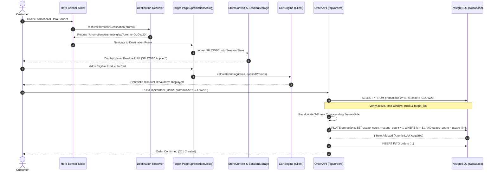

# Promotion Routing & Banner Integration (End-to-End Architecture)

* **Author:** MinnThikeTunn
* **Date:** 2026-11-23
* **Status:** In Review (Drafting Phase)
* **Target Repositories:** Admin Dashboard (`D:/Pretty_Corner_Dashboard`) & Customer Storefront (`D:/Pretty_Corner`)

---

## 1. The Problem

The Pretty Corner e-commerce platform currently suffers from four distinct architectural deficiencies in its marketing and promotions subsystems:

1. **Disconnected Banner Destinations**:
   Marketing hero banners in the customer storefront (`HeroBannerSlider.tsx`) currently route customers to a generic `/shop` URL regardless of the promotion's actual target. If a banner advertises "20% off Dew Drop Serum", customers are dropped into an unfiltered catalog and must manually locate the product.
2. **Missing Promotion-Specific Multi-Product Landing Route**:
   When marketing runs campaigns on curated product sets (e.g., "Selected Beauty Weekend"), the storefront lacks a dynamic route to showcase those specific items. Admins cannot direct traffic to a dedicated promotional view without hardcoding custom pages.
3. **Friction-Heavy & Vulnerable Checkout Experience**:
   Customers must manually memorize and type promo codes at checkout. Furthermore, the cart calculation engine (`CartEngine.ts`) supports only a single, flat discount percentage across the total subtotal. It lacks multi-tier discount stacking (such as item-specific sale pricing compounding with category or storewide vouchers) and lacks server-authoritative revalidation to prevent client-side price tampering.
4. **Manual & Failure-Prone Campaign Deactivation**:
   Promotions remain visible and clickable even after campaigns have temporally expired, exceeded usage quotas, or when all targeted inventory is completely sold out. This leads to customer frustration, broken expectations, and administrative overhead.

---

## 2. Overview

This technical design establishes an end-to-end promotional routing, deactivation, and discount stacking engine spanning both the administrative portal (`D:/Pretty_Corner_Dashboard`) and the customer storefront (`D:/Pretty_Corner`), backed by shared PostgreSQL persistence in Supabase.

The system decouples **Marketing Banner Destination** (where a customer navigates upon clicking a banner) from **Checkout Discount Eligibility** (which items in the cart qualify for discounts), eliminating coupling between browsing and financial calculations.

Additionally, this architecture introduces:
* **Frictionless Auto-Code Ingestion**: Automatically attaches promotion codes to the customer session upon banner interaction, pre-populating checkout fields with full visual transparency.
* **Deterministic Sequential Compound Stacking**: Calculates multi-tier discounts (Item $\to$ Category $\to$ Storewide) using sequential compounding with a safety margin ceiling.
* **Automated Multi-Factor Deactivation**: Automatically hides or disables promotions on expiry, quota exhaustion, or target stockout, with partial degradation support for multi-item sets.
* **Zero-Trust Authoritative Order Verification**: Enforces server-side recalculation and atomic database increments during checkout to eliminate race conditions and client tampering.

---

## 3. Goals

* **Automated Destination Resolution**: Support four explicit target tiers (`SINGLE_PRODUCT`, `SELECTED_PRODUCTS`, `CATEGORY`, `ENTIRE_STORE`) in the admin portal, automatically deriving validated storefront routing URLs (`/product/:slug`, `/promotions/:slug`, `/shop?category=:slug`, `/shop`).
* **Dynamic Promotional Hub**: Implement a dedicated `/promotions/[slug]` route in the storefront that dynamically displays eligible, in-stock products with campaign headers, promotional badges, and countdown timers.
* **Frictionless Auto-Code Attachment**: Seamlessly ingest promotional codes into customer sessions from banner clicks or URL query parameters, displaying immediate visual feedback and pre-filling checkout vouchers.
* **Deterministic Stacking & Margin Protection**: Upgrade `CartEngine.ts` to support sequential compound discounting across item, category, and storewide tiers, protected by a 60% cumulative discount ceiling.
* **Automated Multi-Factor Deactivation**: Automatically exclude or disable promotions that have expired, exceeded `usage_limit`, or whose target products are 100% out of stock, while supporting graceful partial degradation.
* **Authoritative Server Security**: Re-verify promotion rules, line item eligibility, and pricing inside the backend order creation pipeline (`/api/orders`), atomically incrementing usage counts in PostgreSQL.

---

## 4. Non-Goals

* **Arbitrary Landing Page Builder**: We are not building a generic WYSIWYG page designer or block editor for arbitrary custom marketing layouts.
* **Multi-Currency / FX Conversion**: Pricing and discounts remain strictly denominated in Myanmar Kyat (MMK).
* **Cross-Merchant Coupon Sharing**: Promotions are strictly scoped to the Pretty Corner store domain and cannot be redeemed across third-party vendor platforms.
* **Customer Loyalty Points Engine**: A tiered customer loyalty points system is explicitly out of scope for this promotional coupon and banner routing initiative.


---

## 5. Technical Plan

### 5.1 System Architecture & Component Topology

The system connects two distinct Next.js applications through a shared Supabase PostgreSQL database:

```mermaid
flowchart TD
    subgraph AdminPortal ["Admin Portal (D:/Pretty_Corner_Dashboard)"]
        AdminUI["Promotions Management Page (/admin/promotions)"]
        TargetSelector["Target Tier Selector (Single, Selected, Category, Storewide)"]
        PreviewBadge["Live Destination Preview"]
        AdminStore["Admin Store Context & API Client"]
    end

    subgraph SharedDatabase ["Shared Supabase PostgreSQL Instance"]
        PromotionsTable[("promotions Table\n+ slug, target_type, target_ids\n+ usage_limit, usage_count\n+ redemption_method")]
        ProductsTable[("products Table")]
        CategoriesTable[("categories Table")]
        OrdersTable[("orders Table")]
    end

    subgraph CustomerStorefront ["Customer Storefront (D:/Pretty_Corner)"]
        HeroSlider["Hero Banner Slider (HeroBannerSlider.tsx)"]
        Resolver["Destination Resolver (resolvePromotionDestination.ts)"]
        PromoPage["Promotions Hub Page (/promotions/[slug])"]
        ProductPage["Product Detail Page (/product/[id])"]
        ShopPage["Shop Listing Page (/shop)"]
        StoreContext["Store Context & Session Storage (Auto-Code Ingestion)"]
        CartEngine["Cart Engine (3-Phase Compounding Stacking)"]
        OrderAPI["Authoritative Order API (/api/orders)"]
    end

    AdminUI --> TargetSelector --> PreviewBadge
    AdminUI --> AdminStore -->|REST / RPC| PromotionsTable

    PromotionsTable -->|SSR / Client Query| HeroSlider
    HeroSlider --> Resolver
    Resolver -->|Single Product| ProductPage
    Resolver -->|Selected Products| PromoPage
    Resolver -->|Category| ShopPage
    Resolver -->|Entire Store| ShopPage

    HeroSlider -.->|Auto-Attach Promo Code| StoreContext
    PromoPage -.->|Auto-Attach Promo Code| StoreContext
    StoreContext --> CartEngine
    CartEngine -->|Optimistic Display| StoreContext
    StoreContext -->|Order Payload {items, promoCode}| OrderAPI
    OrderAPI -->|Atomic Validation & Lock| PromotionsTable
    OrderAPI --> OrdersTable
```

---

### 5.2 Decoupled Data Flow & User Interaction Lifecycle

The lifecycle strictly segregates browsing destination from transactional eligibility:



---

### 5.3 Database Schema Extensions

We extend the existing Supabase `promotions` table with non-breaking columns:

```sql
-- DDL Migration for Enhanced Promotion Architecture
ALTER TABLE promotions
  ADD COLUMN IF NOT EXISTS slug TEXT UNIQUE,
  ADD COLUMN IF NOT EXISTS target_type TEXT NOT NULL DEFAULT 'ENTIRE_STORE',
  ADD COLUMN IF NOT EXISTS target_ids TEXT[] DEFAULT '{}',
  ADD COLUMN IF NOT EXISTS redemption_method TEXT NOT NULL DEFAULT 'CODE',
  ADD COLUMN IF NOT EXISTS usage_limit INTEGER DEFAULT NULL,
  ADD COLUMN IF NOT EXISTS per_customer_limit INTEGER DEFAULT 1,
  ADD COLUMN IF NOT EXISTS minimum_order_amount NUMERIC DEFAULT 0,
  ADD COLUMN IF NOT EXISTS custom_destination TEXT DEFAULT NULL;

-- Create performance indexes for destination routing and active lookups
CREATE INDEX IF NOT EXISTS idx_promotions_slug ON promotions(slug);
CREATE INDEX IF NOT EXISTS idx_promotions_target_type ON promotions(target_type);
CREATE INDEX IF NOT EXISTS idx_promotions_active_lookup ON promotions(is_active, start_date, end_date);
```

---

### 5.4 Automated Destination Resolver (`resolvePromotionDestination.ts`)

A pure, side-effect-free function deployed isomorphicly to determine routing destinations:

```typescript
export interface ResolveDestinationInput {
  targetType: 'SINGLE_PRODUCT' | 'SELECTED_PRODUCTS' | 'CATEGORY' | 'ENTIRE_STORE';
  slug: string;
  code?: string;
  targetProductSlug?: string;
  targetCategorySlug?: string;
  customDestination?: string;
}

export function resolvePromotionDestination(input: ResolveDestinationInput): string {
  if (input.customDestination?.trim()) {
    return input.customDestination.trim();
  }

  const codeParam = input.code ? `?promo=${encodeURIComponent(input.code)}` : '';

  switch (input.targetType) {
    case 'SINGLE_PRODUCT':
      return input.targetProductSlug
        ? `/product/${input.targetProductSlug}${codeParam}`
        : `/shop${codeParam}`;

    case 'SELECTED_PRODUCTS':
      return `/promotions/${input.slug}${codeParam}`;

    case 'CATEGORY':
      return input.targetCategorySlug
        ? `/shop?category=${encodeURIComponent(input.targetCategorySlug)}${codeParam ? '&' + codeParam.slice(1) : ''}`
        : `/shop${codeParam}`;

    case 'ENTIRE_STORE':
    default:
      return `/shop${codeParam}`;
  }
}
```

---

### 5.5 Dynamic Promotional Hub Page (`/promotions/[slug]/page.tsx`)

A new dynamic route in `D:/Pretty_Corner`:
* **Next.js 16 App Router Compliance**: Asynchronous parameter unwrapping via `const { slug } = await params;`.
* **Layout Structure**:
  1. *Hero Header*: Campaign title, subtitle description, promotional badge, and countdown timer.
  2. *Active Ingestion Trigger*: Automatically injects the promotion code into customer session.
  3. *Responsive Product Grid*: Reuses existing `ProductCardStepper` and `ProductCard` components to display eligible products with discounted pricing.
  4. *Graceful Degradation*: If the promotion is invalid, expired, or all products are out of stock, renders an editorial message ("This promotion has concluded") with a direct CTA to `/shop`.

---

### 5.6 Automatic Code Ingestion & Session State

* **Storefront Context Hook (`StoreContext.tsx`)**:
  * Listens for `?promo=CODE` in URL query parameters on navigation.
  * When detected or when a banner is clicked, calls `applyPromoCode(code)`.
  * Persists the active code in `sessionStorage` (`pretty_corner_active_promo`).
  * Emits an accessible toast notification confirming activation.
* **Cart & Checkout Feedback**:
  * Cart drawer shows applied promo pill with a button to remove or switch codes.
  * Checkout input displays code pre-filled with a green "Auto-Applied" status badge.

---

### 5.7 Deterministic Sequential Compounding Stacking Engine (`CartEngine.ts`)

To protect business margins while providing transparent customer savings, discounts compound sequentially:

```
Item Original Price: P
Step 1: Item Discount (d_item%)     --> P_1 = round(P * (1 - d_item / 100))
Step 2: Category Discount (d_cat%)  --> P_2 = round(P_1 * (1 - d_cat / 100))
Step 3: Storewide Coupon (d_store%) --> Total Storewide Discount applied to sum(P_2 * Q)
```

**Margin Ceiling Safeguard**:
* Total cumulative discount per line item is clamped at a maximum ceiling of **60%** of original retail price $P$.
* Negative pricing is impossible: $\text{LineTotal} \ge 0$.

**Conflict Resolution Invariant**:
* Multiple promotions within the **same target tier** on the same item are mutually exclusive (highest discount percentage takes precedence).

---

### 5.8 Multi-Factor Automated Deactivation Engine

A promotion is deactivated (`is_active = false`) or dynamically filtered out when:
1. **Temporal Expiry**: Current timestamp $< \text{starts\_at}$ OR $> \text{ends\_at}$.
2. **Quota Exhaustion**: $\text{usage\_limit} > 0$ AND $\text{usage\_count} \ge \text{usage\_limit}$.
3. **Inventory Depletion**:
   * `SINGLE_PRODUCT`: Product stock $\le 0$ or status $\neq$ `'Active'`.
   * `SELECTED_PRODUCTS`: **Partial degradation** — if at least 1 product is in stock, the promotion page remains accessible showing only in-stock items. When 100% of linked items are out of stock, the banner and promotion auto-disable.
   * `CATEGORY`: Zero in-stock active items in that category.

---

### 5.9 Zero-Trust Server Order Validation Pipeline

The order placement API endpoint (`/api/orders` in storefront and backend repository) enforces strict server-authoritative integrity:
1. Client submits: `{ customerName, phone, deliveryAddress, township, items: [{ productId, size, quantity }], promoCode }`.
2. The server queries the database for each product's current regular price and stock.
3. The server queries `promotions` table for the matching code and verifies active dates and quotas.
4. The server runs the identical `calculatePricing` algorithm to determine subtotal, line discounts, storewide discount, shipping fee, and grand total.
5. The server executes an atomic conditional update:
   ```sql
   UPDATE promotions
   SET usage_count = usage_count + 1
   WHERE id = $1 AND (usage_limit IS NULL OR usage_count < usage_limit);
   ```
6. If the database update fails due to quota exhaustion, the transaction aborts with `409 Conflict: Promotion usage limit reached`.


---

## 6. Alternatives Considered

### 6.1 Additive Discount Stacking vs. Sequential Compounding

* **Alternative**: Directly adding discount percentages across tiers (e.g., 30% single-product discount + 20% category discount + 15% storewide coupon = 65% total reduction).
* **Decision**: *Rejected by author*. Additive stacking causes severe merchant margin erosion, risks negative or sub-cost retail pricing, and creates unpredictable financial liabilities on high-ticket beauty electronics. Sequential compounding ($P \times (1 - d_1) \times (1 - d_2) \times (1 - d_3)$) accompanied by an explicit 60% cumulative safety floor guarantees mathematically bounded margins while maintaining transparent customer savings.

### 6.2 Fully Decoupled `banners` Table vs. Enhanced `promotions` Table Extension

* **Alternative**: Creating a dedicated `banners` table in PostgreSQL with a foreign key referencing `promotions`, requiring separate admin CRUD screens and relational joins.
* **Decision**: *Rejected by author for this phase*. For Pretty Corner's boutique retail catalog, active marketing campaigns maintain a 1:1 correspondence between hero promotional banners and discount codes. Introducing a separate table creates schema migration overhead, breaks existing client queries in `HeroBannerSlider.tsx`, and fragments the administrative workflow into two separate forms. Augmenting the existing `promotions` table with explicit target tier fields (`target_type`, `target_ids`, `slug`, `custom_destination`) achieves complete destination routing flexibility with zero migration disruption.

### 6.3 Client-Side Discount Authority vs. Zero-Trust Server Revalidation

* **Alternative**: Allowing the client-side cart (`CartEngine.ts`) to calculate final order totals and submit pre-discounted amounts directly to `/api/orders`.
* **Decision**: *Rejected by author*. Client-side pricing authority is inherently vulnerable to payload tampering via browser developer tools or automated scripts, allowing bad actors to inject arbitrary discounts or bypass expiration dates. The system adopts an optimistic client display paired with zero-trust server validation: client totals provide instantaneous UI feedback, but `/api/orders` independently queries the database, verifies promotion validity, recalculates line items, and commits the transaction with atomic usage locks.

### 6.4 Immediate Binary Deactivation vs. Graceful Partial Degradation

* **Alternative**: Automatically deactivating a `SELECTED_PRODUCTS` campaign the moment any single linked product sells out.
* **Decision**: *Rejected by author*. Immediate binary deactivation damages marketing ROI and conversion rates. If 4 out of 5 curated skincare serums remain in stock, the campaign should remain live. The system implements partial degradation: `/promotions/:slug` dynamically presents only available in-stock products, and only triggers automated deactivation when 100% of the linked items hit zero stock.


---

## 7. Detailed Implementation Plan

The implementation is structured into a single, unified execution list spanning both repositories. Every file touched, created, or updated is enumerated below with its explicit rationale.

### 7.1 Unified Execution Checklist

1. **Phase 1: Shared Data Model, TypeScript Contracts & Schemas**
   * [ ] **`D:/Pretty_Corner_Dashboard/src/types/admin.ts`**: Update the `Promotion` interface to add `slug: string`, `targetType: PromotionTargetType`, `targetIds: string[]`, `redemptionMethod: RedemptionMethod`, `usageLimit?: number`, `perCustomerLimit?: number`, `minimumOrderAmount?: number`, and `customDestination?: string`. *Rationale: Establishes type-safe domain contracts for the admin portal.*
   * [ ] **`D:/Pretty_Corner/src/lib/types.ts`**: Mirror the updated `Promotion` interface in the storefront codebase. *Rationale: Ensures strict schema parity between the two applications sharing the same Supabase database.*
   * [ ] **`D:/Pretty_Corner_Dashboard/src/lib/dev-store/schemas.ts`**: Update `PromotionSchema`, `CreatePromotionSchema`, and `UpdatePromotionSchema` using Zod to validate `targetType` enums and string array `targetIds`. *Rationale: Guarantees API-level payload validation and prevents malformed records from persisting.*
   * [ ] **`D:/Pretty_Corner_Dashboard/src/lib/dev-store/supabase-repository.ts`**: Update `SbPromotionRow` interface and `mapPromotionRow` mapper to handle new columns (`target_type`, `target_ids`, `slug`, `usage_limit`, `custom_destination`). *Rationale: Connects PostgreSQL table columns to domain objects.*
   * [ ] **`D:/Pretty_Corner_Dashboard/src/lib/dev-store/seed.ts`**: Add sample test promotions covering all 4 target tiers with pre-assigned slugs. *Rationale: Enables local testing in dev-store fallback mode without requiring manual database seeding.*

2. **Phase 2: Core Pure Logic, Stacking Engine & Automated Test Suite**
   * [ ] **`D:/Pretty_Corner/src/lib/promotion/resolvePromotionDestination.ts` (NEW)**: Create a pure utility module implementing `resolvePromotionDestination(promotion)` that deterministically produces the route URL and appends `?promo=CODE`. *Rationale: Encapsulates navigation derivation logic in an easily unit-testable module.*
   * [ ] **`D:/Pretty_Corner/src/lib/cart/CartEngine.ts`**: Upgrade `calculatePricing` to implement the 3-phase compounding calculation model ($\text{Item} \to \text{Category} \to \text{Storewide}$), applying anti-recursion mutual exclusion within tiers and clamping total line item discounts at the 60% cumulative safety ceiling. *Rationale: Core financial calculation engine ensuring margin preservation and multi-tier discounting.*
   * [ ] **`D:/Pretty_Corner_Dashboard/scripts/test-promotion-architecture.mjs` (NEW)**: Create an end-to-end Node.js test script asserting destination URL generation across all 4 tiers, 3-phase compounding mathematics, 60% margin ceiling clamping, zero negative pricing, anti-recursion invariants, and automated deactivation filters. *Rationale: Provides automated regression verification before UI wiring.*

3. **Phase 3: Customer Storefront Experience (`D:/Pretty_Corner`)**
   * [ ] **`D:/Pretty_Corner/src/components/HeroBannerSlider.tsx`**: Update banner render loop to calculate `ctaDestination` via `resolvePromotionDestination(promo)` instead of hardcoded `/shop`. *Rationale: Directly routes banner clicks to the specific product, promotion hub, or filtered category page.*
   * [ ] **`D:/Pretty_Corner/src/app/promotions/[slug]/page.tsx` (NEW)**: Implement the dynamic promotion hub page adhering to Next.js 16 App Router async parameter unwrapping (`const { slug } = await params`). Displays campaign header, countdown timer, responsive `ProductCard` grid of eligible items, and graceful fallback when invalid or out-of-stock. *Rationale: Solves Problem #2 by providing a dedicated multi-product landing experience.*
   * [ ] **`D:/Pretty_Corner/src/context/StoreContext.tsx`**: Add URL query parameter listener for `?promo=CODE` to automatically ingest coupon codes into session state (`appliedPromoCode`) and persist to `sessionStorage`, firing an accessible visual feedback toast. *Rationale: Delivers frictionless auto-code ingestion without requiring customer memory.*
   * [ ] **`D:/Pretty_Corner/src/app/checkout/page.tsx`**: Update checkout voucher form to display auto-applied promo codes with an "Auto-Applied" status badge and provide clear options to remove or replace codes. *Rationale: Improves checkout ergonomics and reassures customers of applied savings.*
   * [ ] **`D:/Pretty_Corner/src/components/FloatingCartBar.tsx` & `src/components/MobileShell.tsx`**: Update cart summaries to display granular compounded savings line items. *Rationale: Delivers full pricing transparency to customers before final order placement.*

4. **Phase 4: Admin Management Portal (`D:/Pretty_Corner_Dashboard`)**
   * [ ] **`D:/Pretty_Corner_Dashboard/src/app/admin/promotions/page.tsx`**: Redesign promotion creation and editing modal to include:
     * 4-option Target Tier segment selector (`SINGLE_PRODUCT`, `SELECTED_PRODUCTS`, `CATEGORY`, `ENTIRE_STORE`).
     * Conditional picker controls (single product combobox, multi-product tag selector, category dropdown).
     * Live read-only destination URL preview badge.
     * Deactivation status indicators (Active, Expired, Exhausted, Target Out of Stock).
     * *Rationale: Delivers administrative back-office controls required by the specification.*
   * [ ] **`D:/Pretty_Corner_Dashboard/src/app/api/promotions/route.ts` & `[id]/route.ts`**: Handle target tier fields and slug uniqueness validations on API operations. *Rationale: Ensures headless API contracts support the new promotional capabilities.*

5. **Phase 5: Authoritative Order Placement & Concurrency Protection**
   * [ ] **`D:/Pretty_Corner/src/lib/repository/StorefrontRepository.ts` & `src/app/api/orders/route.ts`**: Enhance order placement logic to authoritatively re-verify promotion eligibility, recalculate pricing from database records, and execute atomic conditional usage increments:
     ```sql
     UPDATE promotions
     SET usage_count = usage_count + 1
     WHERE id = $1 AND (usage_limit IS NULL OR usage_count < usage_limit);
     ```
     *Rationale: Guarantees zero-trust security and prevents race condition over-redemption during flash sales.*
