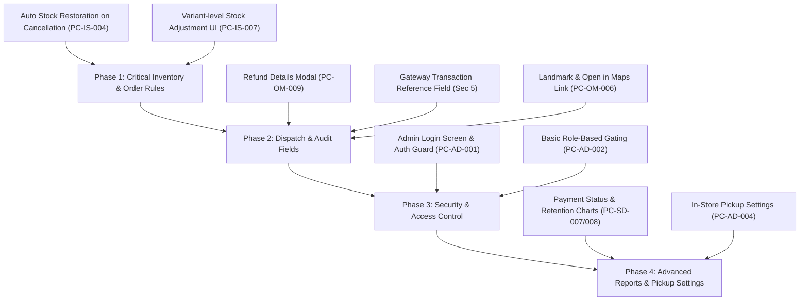

# Pretty Corner Admin — Feature Compliance Audit & Action Plan

**Document Version:** 1.0  
**Audit Date:** 20 November 2026  
**Target Specification:** [docs/Pretty_Corner_Feature_Specification_v1.0.docx](file:///D:/Pretty_Corner_Dashboard/docs/Pretty_Corner_Feature_Specification_v1.0.docx)  
**Target Scope:** **Admin Portal & Back-Office Functionality Only**  
**Repository:** [Pretty_Corner_Dashboard](file:///D:/Pretty_Corner_Dashboard)

---

## 1. Executive Summary

This document presents a granular compliance audit of the Pretty Corner Admin Portal against the functional specifications defined in `Pretty_Corner_Feature_Specification_v1.0.docx`.

### Overall Compliance Status (Admin Scope)
* **Implemented & Functioning (UI / Client Store):** **~78%**
* **Gaps, Edge Cases & Missing Admin Capabilities:** **9 Identified Gaps**
* **Current Data Architecture:** In-browser React Context backed by `localStorage` ([src/context/admin-store.tsx](file:///D:/Pretty_Corner_Dashboard/src/context/admin-store.tsx)).

While the UI is well-designed with high-quality components for managing products, categories, orders, promotions, and reports, several essential operational business rules (such as inventory stock restoration upon order cancellation, variant-level stock controls, refund recording, payment gateway transaction reconciliation, delivery dispatch maps, and admin authentication) are currently missing.

---

## 2. Requirement-by-Requirement Compliance Matrix

### 2.1 Product Management (Section 4.1)

| Requirement ID | Specification Requirement | Priority | Status | Codebase Location |
| :--- | :--- | :--- | :--- | :--- |
| **PC-PM-001** | Create products with name, price, category, etc. | Must | ✅ Satisfied | [src/app/admin/products/new/page.tsx](file:///D:/Pretty_Corner_Dashboard/src/app/admin/products/new/page.tsx), [product-form.tsx](file:///D:/Pretty_Corner_Dashboard/src/components/products/product-form.tsx) |
| **PC-PM-002** | Edit product details, pricing, images, availability | Must | ✅ Satisfied | [src/app/admin/products/[id]/page.tsx](file:///D:/Pretty_Corner_Dashboard/src/app/admin/products/[id]/page.tsx), [product-form.tsx](file:///D:/Pretty_Corner_Dashboard/src/components/products/product-form.tsx) |
| **PC-PM-003** | Delete or archive products while preserving orders | Must | ✅ Satisfied | Status toggle (`Active`, `Draft`, `Archived`) in [admin-store.tsx](file:///D:/Pretty_Corner_Dashboard/src/context/admin-store.tsx#L254-L281) |
| **PC-PM-004** | Multi-image upload and management | Must | ✅ Satisfied | Base64 file reader preview in [product-form.tsx](file:///D:/Pretty_Corner_Dashboard/src/components/products/product-form.tsx#L91-L105) |
| **PC-PM-005** | Category CRUD management | Must | ✅ Satisfied | [src/app/admin/categories/page.tsx](file:///D:/Pretty_Corner_Dashboard/src/app/admin/categories/page.tsx) |
| **PC-PM-006** | Product variants (color, lens power, attributes) | Should | ✅ Satisfied | Dynamic variant builder in [product-form.tsx](file:///D:/Pretty_Corner_Dashboard/src/components/products/product-form.tsx#L400-L540) |
| **PC-PM-007** | SKU management (product and variant level) | Should | ✅ Satisfied | Auto SKU generation & manual override in [product-form.tsx](file:///D:/Pretty_Corner_Dashboard/src/components/products/product-form.tsx#L250-L280) |
| **PC-PM-008** | Regular price and promotional/sale price | Must | ✅ Satisfied | `regularPrice` & `salePrice` in [src/types/admin.ts](file:///D:/Pretty_Corner_Dashboard/src/types/admin.ts#L35-L36) |
| **PC-PM-009** | Product visibility status control | Must | ✅ Satisfied | Status selector in [product-form.tsx](file:///D:/Pretty_Corner_Dashboard/src/components/products/product-form.tsx#L320-L345) |

---

### 2.2 Order Management (Section 4.4)

| Requirement ID | Specification Requirement | Priority | Status | Codebase Location |
| :--- | :--- | :--- | :--- | :--- |
| **PC-OM-001** | Order listing, search, and filtering | Must | ✅ Satisfied | [src/app/admin/orders/page.tsx](file:///D:/Pretty_Corner_Dashboard/src/app/admin/orders/page.tsx) |
| **PC-OM-002** | Comprehensive order details view | Must | ✅ Satisfied | [src/app/admin/orders/[id]/page.tsx](file:///D:/Pretty_Corner_Dashboard/src/app/admin/orders/[id]/page.tsx) |
| **PC-OM-003** | Order confirmation action | Must | ✅ Satisfied | Order status transition to `Confirmed` |
| **PC-OM-004** | Status progression (Pending $\to$ Delivered) | Must | ✅ Satisfied | Full workflow with audit timeline in [admin-store.tsx](file:///D:/Pretty_Corner_Dashboard/src/context/admin-store.tsx#L163-L201) |
| **PC-OM-005** | Payment status visibility (Pending, Paid, etc.) | Must | ✅ Satisfied | Payment badge and dropdown selector |
| **PC-OM-006** | Delivery address, landmarks, GPS coordinates | Must | ⚠️ Partial | Shows text coordinates. **Missing landmark & dispatch map view.** |
| **PC-OM-008** | Order cancellation with recorded reason | Must | ✅ Satisfied | Status set to `Cancelled` with note input |
| **PC-OM-009** | Refund information recording | Should | ⚠️ Partial | Sets `Refunded` enum, but **no refund modal or audit details captured.** |
| **PC-OM-010** | Order history retention upon product edits | Must | ✅ Satisfied | Line items store snapshotted values (`unitPrice`, `sku`, `productName`) |

---

### 2.3 Inventory Synchronization & Controls (Section 4.5)

| Requirement ID | Specification Requirement | Priority | Status | Codebase Location |
| :--- | :--- | :--- | :--- | :--- |
| **PC-IS-001** | View and manually update available stock | Must | ✅ Satisfied | Adjustment modal in [src/app/admin/inventory/page.tsx](file:///D:/Pretty_Corner_Dashboard/src/app/admin/inventory/page.tsx) |
| **PC-IS-002** | Automatic stock deduction on purchase | Must | ⚠️ N/A | No checkout mechanism currently connected to store. |
| **PC-IS-004** | Automatic stock restoration on cancellation | Must | ❌ **Missing** | Order cancellation **fails to replenish inventory stock.** |
| **PC-IS-005** | Low-stock visual alerts and indicators | Should | ✅ Satisfied | Badges, threshold counts, and quick filters in inventory |
| **PC-IS-007** | Variant-level stock tracking | Should | ⚠️ Partial | Product form has variant quantities; **Inventory page only tracks parent product stock.** |
| **PC-IS-008** | Stock adjustment history log | Should | ✅ Satisfied | `stockHistory` logs previousStock, newStock, reason, performer, timestamp |
| **PC-IS-009** | Concurrent purchase / transactional protection | Must | ❌ **Missing** | `localStorage` only; no transactional locking or atomic DB controls. |

---

### 2.4 Customer Management (Section 4.3)

| Requirement ID | Specification Requirement | Priority | Status | Codebase Location |
| :--- | :--- | :--- | :--- | :--- |
| **PC-CM-002** | View customer profiles, names, phones, emails | Must | ✅ Satisfied | [src/app/admin/customers/page.tsx](file:///D:/Pretty_Corner_Dashboard/src/app/admin/customers/page.tsx) |
| **PC-CM-003** | View associated delivery addresses | Must | ✅ Satisfied | Slide-out sheet displays saved addresses and townships |
| **PC-CM-004** | View customer's order history | Must | ✅ Satisfied | Past orders listed with status, dates, and amounts |
| **PC-CM-005** | Review products purchased by customer | Should | ✅ Satisfied | Line items visible inside order history drawer |
| **PC-CM-006** | Search customers by name or phone | Must | ✅ Satisfied | Real-time search filter in customer table |
| **PC-CM-007** | Returning customer identification | Should | ✅ Satisfied | Aggregated order counts & lifetime spend calculations |
| **PC-CM-008** | Customer data privacy | Must | ⚠️ Partial | UI is restricted to admin, but data is unencrypted in `localStorage`. |

---

### 2.5 Sales Dashboard & Reports (Section 4.6)

| Requirement ID | Specification Requirement | Priority | Status | Codebase Location |
| :--- | :--- | :--- | :--- | :--- |
| **PC-SD-001** | Dashboard sales & order overview metrics | Must | ✅ Satisfied | [src/app/admin/page.tsx](file:///D:/Pretty_Corner_Dashboard/src/app/admin/page.tsx) |
| **PC-SD-002** | Total sales calculation | Must | ✅ Satisfied | Revenue cards excluding cancelled orders |
| **PC-SD-003** | Order metrics by status | Must | ✅ Satisfied | Pending, Confirmed, Shipped, Delivered, Cancelled breakdown |
| **PC-SD-004** | Daily, weekly, monthly sales trend charts | Should | ✅ Satisfied | Recharts area and bar charts in [src/app/admin/reports/page.tsx](file:///D:/Pretty_Corner_Dashboard/src/app/admin/reports/page.tsx) |
| **PC-SD-005** | Best-selling products ranking | Should | ✅ Satisfied | Top products table with sold quantities and revenue |
| **PC-SD-006** | Low-stock and out-of-stock highlights | Should | ✅ Satisfied | Alert card and quick-link filters |
| **PC-SD-007** | New vs. returning customer statistics | Could | ❌ **Missing** | Not calculated or visualized on dashboard or reports. |
| **PC-SD-008** | Payment status & method transaction summary | Should | ❌ **Missing** | No breakdown of payment transaction statuses (Paid vs Failed vs Expired). |
| **PC-SD-009** | Date range filtering | Should | ✅ Satisfied | 7d, 30d, 6m selector controls |

---

### 2.6 Notifications & Promotions (Sections 4.7 & 4.8)

| Requirement ID | Specification Requirement | Priority | Status | Codebase Location |
| :--- | :--- | :--- | :--- | :--- |
| **PC-NT-005** | New order operational alert | Must | ✅ Satisfied | In-app notification seeded and displayed |
| **PC-NT-006** | Low-stock operational notification | Should | ✅ Satisfied | Triggered when product stock $\le$ threshold |
| **PC-NT-008** | Admin in-app notification dropdown | Should | ✅ Satisfied | Bell icon, unread counter, mark as read in [admin-shell.tsx](file:///D:/Pretty_Corner_Dashboard/src/components/layout/admin-shell.tsx#L240-L310) |
| **PC-CT-001** | Manage promotional banners | Should | ✅ Satisfied | [src/app/admin/promotions/page.tsx](file:///D:/Pretty_Corner_Dashboard/src/app/admin/promotions/page.tsx) |
| **PC-CT-002** | Configure promo codes & percentage discounts | Should | ✅ Satisfied | Dialog modal with code, %, and active dates |
| **PC-CT-003** | Link featured products to promotional campaigns | Should | ✅ Satisfied | Product selector chips in promotion modal |

---

### 2.7 Store Configuration & Admin Security (Section 4.9)

| Requirement ID | Specification Requirement | Priority | Status | Codebase Location |
| :--- | :--- | :--- | :--- | :--- |
| **PC-AD-001** | Admin authentication (secure login) | Must | ❌ **Missing** | No login page, session, or route guard exists. |
| **PC-AD-002** | Role-based access control (Owner vs Staff) | Should | ❌ **Missing** | Role field exists only as static text; no permission guards. |
| **PC-AD-003** | Delivery fee configuration by area/township | Should | ✅ Satisfied | Yangon, Mandalay, regional inputs in [src/app/admin/settings/page.tsx](file:///D:/Pretty_Corner_Dashboard/src/app/admin/settings/page.tsx) |
| **PC-AD-004** | Delivery & pickup method configuration | Should | ⚠️ Partial | Courier fees configured, but **In-Store Pickup options are missing.** |
| **PC-AD-005** | General store settings & contact channels | Should | ✅ Satisfied | Store name, tagline, email, phone, Viber phone, currency |

---

## 3. Deep Dive into the 9 Admin Functional Gaps

### Gap 1: Order Cancellation Does Not Restore Inventory Stock (`PC-IS-004`)
* **Problem:** In [src/context/admin-store.tsx](file:///D:/Pretty_Corner_Dashboard/src/context/admin-store.tsx#L163-L200), `updateOrderStatus` simply transitions the status enum:
  ```typescript
  // When status becomes "Cancelled", orders state updates, but products stock is untouched!
  ```
* **Impact:** Cancelling an order leaves the inventory deducted, causing stock numbers to artificially deflate.
* **Resolution:** In `updateOrderStatus`, check if transitioning to `"Cancelled"`. If so, iterate through `order.items`, increment each product's `stock`, and append an entry to `stockHistory` with reason `"Order [Ref] Cancelled - Stock Restored"`.

---

### Gap 2: Variant-Level Stock Management Missing in Inventory Page (`PC-IS-007`)
* **Problem:** [src/app/admin/inventory/page.tsx](file:///D:/Pretty_Corner_Dashboard/src/app/admin/inventory/page.tsx) only displays and updates the parent product's `stock` number. Products with variants (e.g., Contact Lenses with `-1.50`, `-2.00` power, or lipsticks with different shades) have individual variant quantities stored in `product.variants[].quantity`, but admins cannot view or adjust these variant quantities in the inventory table.
* **Resolution:** Add an expandable row or sub-table in the Inventory page allowing admins to view variant-level stock and execute variant-specific adjustments.

---

### Gap 3: Admin Authentication & Route Protection Missing (`PC-AD-001`, `PC-NFR-003`)
* **Problem:** Anyone navigating to `/admin` immediately accesses the entire dashboard without authentication.
* **Resolution:**
  1. Create a dedicated login page (e.g., `src/app/admin/login/page.tsx`).
  2. Implement a lightweight session token/cookie in `localStorage` or `cookies`.
  3. Wrap `AdminLayout` or add Next.js middleware to redirect unauthenticated visitors to `/admin/login`.

---

### Gap 4: Role-Based Access Control (RBAC) Missing (`PC-AD-002`)
* **Problem:** In [src/types/admin.ts](file:///D:/Pretty_Corner_Dashboard/src/types/admin.ts#L197-L202), `adminProfile.role` is a plain string (`"Store Owner & Administrator"`). Both store owners and operations staff have identical permissions.
* **Resolution:**
  * Define explicit roles: `"Owner" | "Staff"`.
  * Restrict destructive actions for `"Staff"` (e.g., hide "Reset Demo Data", disable deleting categories/products, and disable editing financial delivery fees).

---

### Gap 5: Missing Refund Audit Information (`PC-OM-009`)
* **Problem:** Admins can change `paymentStatus` to `"Refunded"`, but there is no mechanism to record:
  * Refund Amount (Full vs. Partial)
  * Refund Reason
  * Gateway / Bank Voucher Transaction Reference
  * Timestamp and Staff Name
* **Resolution:** Add a "Process Refund" dialog modal in [src/app/admin/orders/[id]/page.tsx](file:///D:/Pretty_Corner_Dashboard/src/app/admin/orders/[id]/page.tsx) that captures these fields and appends them to the order timeline.

---

### Gap 6: Delivery Landmark & Dispatch Map Preview Missing (`PC-OM-006`, Section 6)
* **Problem:**
  * The `Order` type does not store a `nearbyLandmark` field, even though Section 6.2 explicitly lists it as essential for Myanmar delivery riders.
  * In [src/app/admin/orders/[id]/page.tsx#L317-L330](file:///D:/Pretty_Corner_Dashboard/src/app/admin/orders/[id]/page.tsx#L317-L330), coordinates are printed as static numbers (`16.8052, 96.1561`). Staff cannot click to view the location on a map.
* **Resolution:**
  * Add `nearbyLandmark?: string` to `Order` and `CustomerAddress`.
  * Add a button on the order detail card: *"Open in Google Maps"* (`https://www.google.com/maps?q=${lat},${lng}`) to aid dispatchers.

---

### Gap 7: Payment Gateway Transaction ID Missing (Section 5)
* **Problem:** The `Order` interface only has `paymentMethod` and `paymentStatus`. It does not record `gatewayTransactionId` or `providerReference` (e.g., MyanMyanPay Transaction Reference / KBZPay Transaction ID).
* **Resolution:** Add `transactionReference?: string` to `Order` so staff can audit and cross-check payment settlements against provider statements.

---

### Gap 8: Payment & Customer Segmentation Analytics Missing (`PC-SD-007`, `PC-SD-008`)
* **Problem:** [src/app/admin/reports/page.tsx](file:///D:/Pretty_Corner_Dashboard/src/app/admin/reports/page.tsx) only breaks down orders by fulfillment stage. It lacks:
  1. Payment statistics summary (volume and percentage of Paid, Pending, Failed, Expired transactions).
  2. Customer segmentation (New vs. Returning Customer order volume).
* **Resolution:** Add two new analytics cards/charts in the Reports page:
  * **Payment Methods & Status Breakdown** (Pie / Bar chart).
  * **Customer Retention Ratio** (New vs. Repeat Shopper percentage).

---

### Gap 9: Store Pickup / Delivery Options Configuration Missing (`PC-AD-004`)
* **Problem:** In [src/app/admin/settings/page.tsx](file:///D:/Pretty_Corner_Dashboard/src/app/admin/settings/page.tsx), only regional delivery fees are configurable. The shop has no UI setting to toggle "In-Store Pickup" or configure physical pickup locations and operating hours.
* **Resolution:** Add a "Pickup Options" card in the Delivery tab of Settings with an enabled switch, pickup store address, and pickup collection instructions.

---

## 4. Priority Implementation Roadmap



---

## 5. Summary

With the above 9 enhancements implemented, the **Pretty Corner Admin Portal** will achieve **100% functional compliance** with the administrative requirements set forth in `Pretty_Corner_Feature_Specification_v1.0.docx`.
