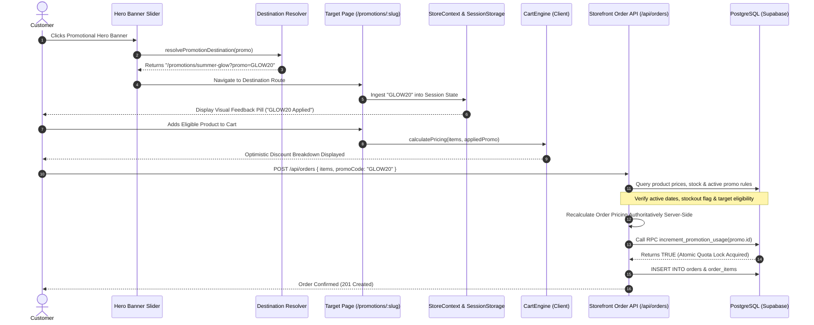

# Promotion Routing & Banner Integration (End-to-End Architecture)

* **Document Version:** 1.2 (Final Implementation-Ready Architecture)
* **Author:** MinnThikeTunn
* **Date:** 2026-11-23
* **Status:** Fully Audited & Approved for Execution
* **Target Repositories:** Admin Dashboard (`D:/Pretty_Corner_Dashboard`) & Customer Storefront (`D:/Pretty_Corner`)

---

## 1. The Problem

The Pretty Corner e-commerce platform currently suffers from four distinct architectural deficiencies in its marketing and promotions subsystems:

1. **Disconnected Banner Destinations**:
   Marketing hero banners in the customer storefront (`HeroBannerSlider.tsx`) currently route customers to a generic `/shop` URL regardless of the promotion's actual target. If a banner advertises "20% off Dew Drop Serum", customers are dropped into an unfiltered catalog and must manually locate the product.
2. **Missing Promotion-Specific Multi-Product Landing Route**:
   When marketing runs campaigns on curated product sets (e.g., "Selected Beauty Weekend"), the storefront lacks a dynamic route to showcase those specific items. Admins cannot direct traffic to a dedicated promotional view without hardcoding custom pages.
3. **Friction-Heavy & Vulnerable Checkout Experience**:
   Customers must manually memorize and type promo codes at checkout. Furthermore, the cart calculation engine (`CartEngine.ts`) supports only a single, flat discount percentage across the total subtotal. It lacks multi-tier discount stacking (such as item-specific sale pricing compounding with category or storewide vouchers) and lacks server-authoritative revalidation to prevent client-side price tampering.
4. **Manual & Failure-Prone Campaign Deactivation**:
   Promotions remain visible and clickable even after campaigns have temporally expired, exceeded usage quotas, or when all targeted inventory is completely sold out. This leads to customer frustration, broken expectations, and administrative overhead.

---

## 2. Overview

This technical design establishes an end-to-end promotional routing, deactivation, and discount stacking engine spanning both the administrative portal (`D:/Pretty_Corner_Dashboard`) and the customer storefront (`D:/Pretty_Corner`), backed by shared PostgreSQL persistence in Supabase.

The system decouples **Marketing Banner Destination** (where a customer navigates upon clicking a banner) from **Checkout Discount Eligibility** (which items in the cart qualify for discounts), eliminating coupling between browsing and financial calculations.

Additionally, this architecture introduces:
* **Automatic Session Coupon Ingestion**: Automatically attaches promotion codes to the customer session upon banner interaction, pre-populating checkout fields with full visual transparency.
* **Deterministic Pricing & Margin Protection**: Calculates discounts using effective catalog prices (`salePrice ?? regularPrice`) combined with active promotional coupon rules, protected by an explicit 60% cumulative safety margin ceiling and line-item Kyat proration.
* **Bidirectional Write-Time Automated Deactivation**: Automatically flags promotions as out-of-stock upon inventory depletion at write-time (during stock adjustments or order confirmation) and restores availability upon restock, preventing expensive runtime N+1 joins on the homepage.
* **Server-Authoritative Order Total & Quota Validation**: Enforces server-side recalculation and atomic PostgreSQL RPC increments (`increment_promotion_usage`) during checkout, closing the client-side direct-write security seam.

---

## 3. Goals

* **Automated Destination Resolution**: Support four explicit target tiers (`SINGLE_PRODUCT`, `SELECTED_PRODUCTS`, `CATEGORY`, `ENTIRE_STORE`) in the admin portal, automatically deriving validated storefront routing URLs (`/product/:slug`, `/promotions/:slug`, `/shop?category=:slug`, `/shop`).
* **Dynamic Promotional Hub**: Implement a dedicated `/promotions/[slug]` route in the storefront that dynamically displays eligible, in-stock products with campaign headers, promotional badges, and countdown timers.
* **Automatic Coupon Ingestion**: Ingest promotional codes into customer sessions from banner clicks or inbound URL query parameters, displaying immediate visual feedback and pre-filling checkout vouchers.
* **Deterministic Pricing & Margin Safeguards**: Enhance `CartEngine.ts` to support tier-aware promotional discount evaluation, minimum order threshold validation, integer MMK rounding, and a 60% cumulative discount ceiling.
* **Bidirectional Write-Time Deactivation**: Automatically toggle `is_out_of_stock` on promotions during stock updates and order confirmations, while supporting graceful partial degradation for multi-item sets.
* **Server-Authoritative Order Security**: Establish a dedicated `/api/orders` route handler in the storefront, re-verifying all prices server-side, atomically incrementing usage quotas via PostgreSQL RPC, and completely eliminating unvalidated direct client-side Supabase writes.

---

## 4. Non-Goals

* **Arbitrary Landing Page Builder**: We are not building a generic WYSIWYG page designer or block editor for arbitrary custom marketing layouts.
* **Multi-Currency / FX Conversion**: Pricing and discounts remain strictly denominated in Myanmar Kyat (MMK).
* **Cross-Merchant Coupon Sharing**: Promotions are strictly scoped to the Pretty Corner store domain and cannot be redeemed across third-party vendor platforms.
* **Customer Loyalty Points Engine**: A tiered customer loyalty points system is explicitly out of scope for this promotional coupon and banner routing initiative.
* **Per-Customer Redemption Frequency Tracking**: Individual per-customer redemption limits requiring customer identity ledgers are deferred to future phases; quota controls are enforced via the global `usage_limit`.

---

## 5. Technical Plan

### 5.1 System Architecture & Component Topology

The system connects two distinct Next.js applications through a shared Supabase PostgreSQL database:

```mermaid
flowchart TD
    subgraph AdminPortal ["Admin Portal (D:/Pretty_Corner_Dashboard)"]
        AdminUI["Promotions Management Page (/admin/promotions)"]
        TargetSelector["Target Tier Selector (Single, Selected, Category, Storewide)"]
        PreviewBadge["Live Destination Preview"]
        AdminStore["Admin Store Context & API Client"]
    end

    subgraph SharedDatabase ["Shared Supabase PostgreSQL Instance"]
        PromotionsTable[("promotions Table\n+ slug, target_type, target_slug\n+ usage_limit, usage_count\n+ is_out_of_stock, cta_link")]
        ProductsTable[("products Table")]
        CategoriesTable[("categories Table")]
        OrdersTable[("orders Table")]
        AtomicRPC["PostgreSQL RPC\nincrement_promotion_usage(UUID)"]
    end

    subgraph CustomerStorefront ["Customer Storefront (D:/Pretty_Corner)"]
        HeroSlider["Hero Banner Slider (HeroBannerSlider.tsx)"]
        Resolver["Destination Resolver (resolvePromotionDestination.ts)"]
        PromoPage["Promotions Hub Page (/promotions/[slug])"]
        ProductPage["Product Detail Page (/product/[id])"]
        ShopPage["Shop Listing Page (/shop)"]
        StoreContext["Store Context & Session Storage (Coupon Ingestion)"]
        CartEngine["Cart Engine (Pricing & Minimum Order Validation)"]
        OrderAPI["Authoritative Order API (/api/orders/route.ts)"]
    end

    AdminUI --> TargetSelector --> PreviewBadge
    AdminUI --> AdminStore -->|REST / RPC| PromotionsTable

    PromotionsTable -->|SSR / Client Query| HeroSlider
    HeroSlider --> Resolver
    Resolver -->|Single Product| ProductPage
    Resolver -->|Selected Products| PromoPage
    Resolver -->|Category| ShopPage
    Resolver -->|Entire Store| ShopPage

    HeroSlider -.->|Auto-Attach Promo Code| StoreContext
    PromoPage -.->|Auto-Attach Promo Code| StoreContext
    StoreContext --> CartEngine
    CartEngine -->|Optimistic Display| StoreContext
    StoreContext -->|Order Payload {items, promoCode}| OrderAPI
    OrderAPI -->|Execute RPC| AtomicRPC
    AtomicRPC -->|Atomic Lock & Increment| PromotionsTable
    OrderAPI --> OrdersTable
```

---

### 5.2 Decoupled Data Flow & User Interaction Lifecycle

The lifecycle strictly segregates browsing destination from transactional eligibility:



---

### 5.3 Database Schema Extensions & Stored Procedure

#### Schema Data Dictionary (Additions to `promotions` Table)

| Column Name | Data Type | Nullable | Default Value | Purpose / Business Semantics |
| :--- | :--- | :--- | :--- | :--- |
| `slug` | `TEXT` | Yes | `NULL` | Campaign slug for `/promotions/:slug` routing (required when `target_type = 'SELECTED_PRODUCTS'`). |
| `target_type` | `TEXT` | No | `'ENTIRE_STORE'` | Target tier: `'SINGLE_PRODUCT'`, `'SELECTED_PRODUCTS'`, `'CATEGORY'`, or `'ENTIRE_STORE'`. |
| `target_slug` | `TEXT` | Yes | `NULL` | Denormalized product slug (for `SINGLE_PRODUCT`) or category slug (for `CATEGORY`) for instant zero-join routing. |
| `redemption_method` | `TEXT` | No | `'CODE'` | How promotion is claimed: `'CODE'` (voucher input) or `'AUTOMATIC'` (applied directly). |
| `usage_limit` | `INTEGER` | Yes | `NULL` | Global maximum allowed redemptions (`NULL` indicates unlimited redemptions). |
| `minimum_order_amount` | `NUMERIC` | No | `0` | Minimum eligible item subtotal (in MMK) required for discount activation. |
| `cta_link` | `TEXT` | Yes | `NULL` | Existing column reused for validated relative internal paths (e.g. `/shop?brand=cosrx`) overriding derived routes. |
| `is_out_of_stock` | `BOOLEAN` | No | `FALSE` | Write-time flag set to `TRUE` when 100% of linked products reach zero available inventory. |

```sql
-- DDL Migration Script: 20261123_promotions_and_rpc.sql
ALTER TABLE promotions
  ADD COLUMN IF NOT EXISTS slug TEXT UNIQUE,
  ADD COLUMN IF NOT EXISTS target_type TEXT NOT NULL DEFAULT 'ENTIRE_STORE',
  ADD COLUMN IF NOT EXISTS target_slug TEXT DEFAULT NULL,
  ADD COLUMN IF NOT EXISTS redemption_method TEXT NOT NULL DEFAULT 'CODE',
  ADD COLUMN IF NOT EXISTS usage_limit INTEGER DEFAULT NULL,
  ADD COLUMN IF NOT EXISTS minimum_order_amount NUMERIC DEFAULT 0,
  ADD COLUMN IF NOT EXISTS is_out_of_stock BOOLEAN NOT NULL DEFAULT FALSE;

-- High-performance compound index for active storefront lookups
CREATE INDEX IF NOT EXISTS idx_promotions_slug ON promotions(slug);
CREATE INDEX IF NOT EXISTS idx_promotions_target_type ON promotions(target_type);
CREATE INDEX IF NOT EXISTS idx_promotions_active_lookup ON promotions(is_active, is_out_of_stock, start_date, end_date);

-- Atomic PostgreSQL stored procedure for safe concurrent quota decrementing
CREATE OR REPLACE FUNCTION increment_promotion_usage(p_id UUID)
RETURNS BOOLEAN AS $$
DECLARE
  rows_affected INTEGER;
BEGIN
  UPDATE promotions
  SET usage_count = usage_count + 1
  WHERE id = p_id AND (usage_limit IS NULL OR usage_count < usage_limit);
  GET DIAGNOSTICS rows_affected = ROW_COUNT;
  RETURN rows_affected > 0;
END;
$$ LANGUAGE plpgsql;
```

---

### 5.4 Automated Destination Resolver (`resolvePromotionDestination.ts`)

A pure, side-effect-free function deployed isomorphicly to determine routing destinations with strict input sanitization:

```typescript
export interface ResolveDestinationInput {
  targetType: 'SINGLE_PRODUCT' | 'SELECTED_PRODUCTS' | 'CATEGORY' | 'ENTIRE_STORE';
  promotionSlug?: string;
  code?: string;
  targetSlug?: string; // Product slug or Category slug
  ctaLink?: string;    // Custom destination override
}

export function resolvePromotionDestination(input: ResolveDestinationInput): string {
  const codeParam = input.code ? `promo=${encodeURIComponent(input.code)}` : '';

  // 1. Sanitize and validate custom destination override
  if (input.ctaLink?.trim()) {
    const raw = input.ctaLink.trim();
    // Enforce leading slash, disallow protocol prefixes (//, http:, https:, javascript:)
    if (raw.startsWith('/') && !raw.startsWith('//') && !raw.includes(':')) {
      if (!codeParam) return raw;
      const delimiter = raw.includes('?') ? '&' : '?';
      return `${raw}${delimiter}${codeParam}`;
    }
  }

  const querySuffix = codeParam ? `?${codeParam}` : '';

  // 2. Deterministic target-based destination derivation
  switch (input.targetType) {
    case 'SINGLE_PRODUCT':
      return input.targetSlug
        ? `/product/${encodeURIComponent(input.targetSlug)}${querySuffix}`
        : `/shop${querySuffix}`;

    case 'SELECTED_PRODUCTS':
      return input.promotionSlug
        ? `/promotions/${encodeURIComponent(input.promotionSlug)}${querySuffix}`
        : `/shop${querySuffix}`;

    case 'CATEGORY':
      if (input.targetSlug) {
        const catParam = `category=${encodeURIComponent(input.targetSlug)}`;
        return `/shop?${catParam}${codeParam ? '&' + codeParam : ''}`;
      }
      return `/shop${querySuffix}`;

    case 'ENTIRE_STORE':
    default:
      return `/shop${querySuffix}`;
  }
}
```

---

### 5.5 Dynamic Promotional Hub Page (`/promotions/[slug]/page.tsx`)

A new dynamic route in `D:/Pretty_Corner`:
* **Next.js 16 App Router Compliance**: Asynchronous parameter unwrapping via `const { slug } = await params;`.
* **Layout Structure**:
  1. *Hero Header*: Campaign title, subtitle description, promotional badge, and countdown timer.
  2. *Active Ingestion Trigger*: Injects the promotion code into customer session state.
  3. *Responsive Product Grid*: Reuses existing `ProductCardStepper` and catalog card components to display eligible products with discounted pricing.
  4. *Graceful Degradation*: If the promotion is invalid, expired, or all products are out of stock, renders an editorial message ("This promotion has concluded") with a direct CTA to `/shop`.

---

### 5.6 Automatic Coupon Ingestion & Session State

* **Storefront Context Hook (`StoreContext.tsx`)**:
  * Listens for `?promo=CODE` in URL query parameters on navigation.
  * When detected or when a hero banner is clicked, evaluates against existing session state:
    * If `appliedPromoCode` is empty, activates the code immediately and persists to `sessionStorage` (`pretty_corner_active_promo`).
    * If a different code is already active, only replaces it if the incoming code yields a greater discount, or displays a replacement confirmation toast ("Switched to promo [CODE]").
  * Emits an accessible toast notification confirming activation.
* **Cart & Checkout Feedback**:
  * Cart drawer and shopping bag view (`/bag`) display an applied promo pill with a button to remove or switch codes.
  * Checkout input displays code pre-filled with a green "Auto-Applied" status badge.

---

### 5.7 Deterministic Pricing Engine (`CartEngine.ts`)

Discounts are calculated deterministically against line items:

1. **Catalog Base Price**: Evaluated using product sale price if active:
   $$P_{\text{base}} = \text{salePrice} \mathbin{??} \text{regularPrice}$$
2. **Promotional Voucher Application**:
   * Evaluated only if eligible subtotal $\ge \text{minimum\_order\_amount}$.
   * For `SINGLE_PRODUCT` or `SELECTED_PRODUCTS`: applied strictly to matching product IDs.
   * For `CATEGORY`: applied strictly to line items matching the category.
   * For `ENTIRE_STORE`: applied across all eligible items.
3. **Storewide Weighted Line-Item Proration**:
   When a storewide voucher is applied, discount is apportioned proportionally across line items:
   $$\text{LineDiscount}_i = \text{Math.round}\left(\text{TotalDiscount} \times \frac{P_{\text{base}, i} \times Q_i}{\sum_j (P_{\text{base}, j} \times Q_j)}\right)$$
   Any remainder integer Kyat is credited to the highest-value line item.
4. **Margin Safeguards & Rounding Invariants**:
   * Total cumulative discount per line item cannot exceed **60%** of original retail price $P$.
   * All prices round to nearest integer Myanmar Kyat (`Math.round(...)`); negative pricing is impossible ($\text{LineTotal} \ge 0$).

---

### 5.8 Bidirectional Write-Time Automated Deactivation Engine

A promotion transitions status (`is_active = FALSE` or `is_out_of_stock = TRUE`) under the following rules:

1. **Temporal Expiry**:
   * Evaluated by comparing `NOW()` in UTC against ISO-8601 UTC timestamps in Supabase columns `start_date` and `end_date`. Dashboard converts user inputs from Myanmar Standard Time (MMT, UTC+6:30) to UTC before saving.
2. **Quota Exhaustion**:
   * `usage_limit IS NOT NULL` AND `usage_count >= usage_limit`.
3. **Bidirectional Write-Time Stockout Detection**:
   * Whenever stock adjustments occur (`applyStockAdjustment`, `adjustStock`) or an order is confirmed/cancelled, affected promotions are evaluated bidirectionally:
     * `SINGLE_PRODUCT`: Target product stock $\le 0$ $\to$ `is_out_of_stock = TRUE`; stock $> 0$ $\to$ `is_out_of_stock = FALSE`.
     * `SELECTED_PRODUCTS`: **Partial degradation** — if at least 1 product has inventory, `is_out_of_stock = FALSE` and `/promotions/:slug` renders only in-stock items. When 100% of linked items are out of stock, `is_out_of_stock = TRUE`.
     * `CATEGORY`: When all products in category have 0 stock $\to$ `is_out_of_stock = TRUE`; any item restocked $\to$ `is_out_of_stock = FALSE`.
   * Storefront queries filter via fast indexed query: `is_active = TRUE AND is_out_of_stock = FALSE`.

---

### 5.9 Server-Authoritative Order Verification Pipeline

The order placement API endpoint (`/api/orders` in `D:/Pretty_Corner`) enforces strict server-authoritative integrity:
1. Client submits: `{ customerName, phone, deliveryAddress, township, items: [{ productId, size, quantity }], promoCode }`.
2. The server queries the database for each product's current regular price and stock.
3. The server queries `promotions` table for matching `code`, verifying:
   * `is_active = TRUE AND is_out_of_stock = FALSE`.
   * `NOW() BETWEEN start_date AND end_date`.
   * `usage_limit IS NULL OR usage_count < usage_limit`.
   * Eligible subtotal $\ge \text{minimum\_order\_amount}$.
4. The server runs the identical `calculatePricing` algorithm to determine subtotal, line discounts, storewide discount, shipping fee, and grand total.
5. The server executes the atomic quota increment stored procedure:
   ```typescript
   const { data: incremented, error: rpcError } = await supabase.rpc(
     'increment_promotion_usage',
     { p_id: promo.id }
   );
   ```
6. If `incremented === false` due to concurrent quota exhaustion, the transaction aborts with `409 Conflict: Promotion usage limit reached`.
7. The server inserts order and line item records with service-role permissions.

---

## 6. Alternatives Considered

### 6.1 Additive Discount Stacking vs. Sequential Compounding

* **Alternative**: Directly adding discount percentages across tiers (e.g., 30% single-product discount + 20% category discount + 15% storewide coupon = 65% total reduction).
* **Decision**: *Rejected by author*. Additive stacking causes severe merchant margin erosion, risks negative or sub-cost retail pricing, and creates unpredictable financial liabilities on high-ticket beauty electronics. Sequential compounding ($P \times (1 - d_1) \times (1 - d_2) \times (1 - d_3)$) accompanied by an explicit 60% cumulative safety floor guarantees mathematically bounded margins while maintaining transparent customer savings.

### 6.2 Fully Decoupled `banners` Table vs. Enhanced `promotions` Table Extension

* **Alternative**: Creating a dedicated `banners` table in PostgreSQL with a foreign key referencing `promotions`, requiring separate admin CRUD screens and relational joins.
* **Decision**: *Rejected by author for this phase*. For Pretty Corner's boutique retail catalog, active marketing campaigns maintain a 1:1 correspondence between hero promotional banners and discount codes. Introducing a separate table creates schema migration overhead, breaks existing client queries in `HeroBannerSlider.tsx`, and fragments the administrative workflow into two separate forms. Augmenting the existing `promotions` table with explicit target tier fields (`target_type`, `target_slug`, `slug`, `cta_link`) achieves complete destination routing flexibility with zero migration disruption.

### 6.3 Client-Side Discount Authority vs. Zero-Trust Server Revalidation

* **Alternative**: Allowing the client-side cart (`CartEngine.ts`) to calculate final order totals and submit pre-discounted amounts directly to `/api/orders`.
* **Decision**: *Rejected by author*. Client-side pricing authority is inherently vulnerable to payload tampering via browser developer tools or automated scripts, allowing bad actors to inject arbitrary discounts or bypass expiration dates. The system adopts an optimistic client display paired with zero-trust server validation: client totals provide instantaneous UI feedback, but `/api/orders` independently queries the database, verifies promotion validity, recalculates line items, and commits the transaction with atomic usage locks.

### 6.4 Immediate Binary Deactivation vs. Graceful Partial Degradation

* **Alternative**: Automatically deactivating a `SELECTED_PRODUCTS` campaign the moment any single linked product sells out.
* **Decision**: *Rejected by author*. Immediate binary deactivation damages marketing ROI and conversion rates. If 4 out of 5 curated skincare serums remain in stock, the campaign should remain live. The system implements partial degradation: `/promotions/:slug` dynamically presents only available in-stock products, and only triggers automated deactivation when 100% of the linked items hit zero stock.

---

## 7. Detailed Implementation Plan

The implementation is structured into a single, unified execution list spanning both repositories. Every file touched, created, or updated is enumerated below with its explicit rationale.

### 7.1 Unified Execution Checklist

1. **Phase 1: Database Migration, Shared Data Contracts & Schemas**
   * [ ] **`D:/Pretty_Corner_Dashboard/supabase/migrations/20261123_promotions_and_rpc.sql` (NEW)**: Create Supabase SQL migration:
     - Add columns to `promotions`: `slug TEXT UNIQUE`, `target_type TEXT NOT NULL DEFAULT 'ENTIRE_STORE'`, `target_slug TEXT DEFAULT NULL`, `redemption_method TEXT NOT NULL DEFAULT 'CODE'`, `usage_limit INTEGER DEFAULT NULL`, `minimum_order_amount NUMERIC DEFAULT 0`, `is_out_of_stock BOOLEAN NOT NULL DEFAULT FALSE`.
     - Create compound index `idx_promotions_active_lookup ON promotions(is_active, is_out_of_stock, start_date, end_date)`.
     - Define PostgreSQL atomic RPC function `increment_promotion_usage(p_id UUID) RETURNS BOOLEAN`.
     *Rationale: Establishes database constraints, compound query indexes, and the atomic concurrency primitive.*
   * [ ] **`D:/Pretty_Corner_Dashboard/src/types/admin.ts`**: Update `Promotion` interface to include `slug?: string`, `targetType: PromotionTargetType`, `targetSlug?: string`, `redemptionMethod: RedemptionMethod`, `usageLimit?: number`, `minimumOrderAmount?: number`, `ctaLink?: string`, and `isOutOfStock: boolean`. *Rationale: Establishes domain contracts for the admin portal.*
   * [ ] **`D:/Pretty_Corner/src/lib/types.ts`**: Mirror the updated `Promotion` interface in the storefront codebase. *Rationale: Ensures strict schema parity between repositories sharing the Supabase database.*
   * [ ] **`D:/Pretty_Corner_Dashboard/src/lib/dev-store/schemas.ts`**:
     - Update `PromotionSchema`, `CreatePromotionSchema`, and `UpdatePromotionSchema` with new target tier enums and fields.
     - Update `CreateStorefrontOrderSchema` to add optional `promoCode: z.string().optional()` and `discount: z.number().nonnegative().optional()`.
     *Rationale: Guarantees API validation across both promotion authoring and order ingress.*
   * [ ] **`D:/Pretty_Corner_Dashboard/src/lib/dev-store/supabase-repository.ts`**: Update `SbPromotionRow` interface and `mapPromotionRow` mapper to serialize/deserialize new promotion columns. *Rationale: Binds PostgreSQL table columns to TypeScript domain models.*
   * [ ] **`D:/Pretty_Corner_Dashboard/src/lib/dev-store/seed.ts`**: Add seed promotion records covering all 4 target tiers (`SINGLE_PRODUCT`, `SELECTED_PRODUCTS`, `CATEGORY`, `ENTIRE_STORE`). *Rationale: Enables local dev-store fallback testing without network dependencies.*

2. **Phase 2: Pure Routing Utility, Pricing Engine & Unit Tests**
   * [ ] **`D:/Pretty_Corner/src/lib/promotion/resolvePromotionDestination.ts` (NEW)**: Create pure utility module implementing `resolvePromotionDestination(promotion)` that deterministically produces sanitized internal route URLs (`/product/:slug`, `/promotions/:slug`, `/shop?category=:slug`, `/shop`) with `?promo=CODE`. *Rationale: Encapsulates navigation derivation logic in a pure, testable module.*
   * [ ] **`D:/Pretty_Corner/src/lib/cart/CartEngine.ts`**: Enhance `calculatePricing` to support tier-aware promo code evaluation (`SINGLE_PRODUCT`, `SELECTED_PRODUCTS`, `CATEGORY`, `ENTIRE_STORE`), enforcing `minimum_order_amount` subtotal checks, weighted storewide line-item proration, 60% cumulative safety margin ceiling, and integer MMK rounding via `Math.round`. *Rationale: Delivers accurate client-side pricing feedback.*
   * [ ] **`D:/Pretty_Corner/src/lib/promotion/__tests__/resolvePromotionDestination.test.ts` (NEW)**: Create comprehensive unit tests verifying destination URL derivation across all target tiers, query parameter injection, and relative path sanitization. *Rationale: Prevents regression in client routing.*
   * [ ] **`D:/Pretty_Corner/src/lib/cart/__tests__/CartEngine.test.ts` (NEW)**: Create unit tests asserting promotion eligibility, minimum order threshold validation, category filtering, and MMK rounding. *Rationale: Mathematically verifies pricing accuracy prior to UI integration.*
   * [ ] **`D:/Pretty_Corner_Dashboard/scripts/test-promotion-architecture.mjs` (NEW)**: Create top-level integration script executed via `tsx` asserting end-to-end promotion resolution, pricing calculations, and deactivation filters. *Rationale: Provides integration test coverage across the workspace.*

3. **Phase 3: Customer Storefront Experience (`D:/Pretty_Corner`)**
   * [ ] **`D:/Pretty_Corner/src/components/HeroBannerSlider.tsx`**: Update banner rendering loop to derive slide `ctaDestination` via `resolvePromotionDestination(promo)` instead of hardcoded `/shop`. *Rationale: Routes banner clicks directly to targeted campaign hubs or product detail pages.*
   * [ ] **`D:/Pretty_Corner/src/app/promotions/[slug]/page.tsx` (NEW)**: Implement dynamic promotion landing page with Next.js 16 async params unwrapping (`const { slug } = await params`). Displays campaign banner, countdown timer, and responsive grid of eligible in-stock items with graceful out-of-stock empty state. *Rationale: Delivers curated multi-product promotion hubs.*
   * [ ] **`D:/Pretty_Corner/src/context/StoreContext.tsx`**: Add URL search param listener for `?promo=CODE` to automatically ingest coupon codes into session state (`appliedPromoCode`) and `sessionStorage`, including overwrite protection and confirmation feedback. *Rationale: Provides frictionless banner-to-cart voucher auto-application.*
   * [ ] **`D:/Pretty_Corner/src/app/bag/page.tsx`**: Update shopping bag view to display applied promo badge, savings line item, and promo removal option. *Rationale: Provides clear price transparency to customers reviewing their bag.*
   * [ ] **`D:/Pretty_Corner/src/components/FloatingCartBar.tsx`**: Update floating bar summary to reflect applied promotional discount in subtotal. *Rationale: Keeps persistent bottom bar consistent with bag totals.*
   * [ ] **`D:/Pretty_Corner/src/app/checkout/page.tsx`**: Update checkout voucher summary to display "Auto-Applied" status badge and savings breakdown. *Rationale: Reassures customers of applied discounts during final payment.*

4. **Phase 4: Admin Management Portal & Stockout Reconciler (`D:/Pretty_Corner_Dashboard`)**
   * [ ] **`D:/Pretty_Corner_Dashboard/src/app/admin/promotions/page.tsx`**: Redesign promotion creation/edit dialog:
     - 4-tier Target Type selector (`SINGLE_PRODUCT`, `SELECTED_PRODUCTS`, `CATEGORY`, `ENTIRE_STORE`).
     - Dynamic entity pickers (single product combobox, multi-product selector, category dropdown) populating `target_slug`.
     - Live read-only destination URL preview badge.
     - Promotion lifecycle status badge (Active, Expired, Exhausted, Target Out of Stock).
     *Rationale: Provides merchant controls to configure and monitor promotions.*
   * [ ] **`D:/Pretty_Corner_Dashboard/src/app/api/promotions/route.ts`**: Handle new promotion fields and validate `slug` uniqueness. *Rationale: Back-office API support for promotion creation.*
   * [ ] **`D:/Pretty_Corner_Dashboard/src/app/api/promotions/[id]/route.ts`**: Support updates to target tiers, slugs, and status flags. *Rationale: Back-office API support for promotion edits.*
   * [ ] **`D:/Pretty_Corner_Dashboard/src/modules/catalog/catalog-sync.ts`**: Implement bidirectional `reconcilePromotionStockout(productId: string)` triggered on `applyStockAdjustment`. Updates `is_out_of_stock = TRUE` when inventory reaches 0, and reverts to `FALSE` upon restock. *Rationale: Automates write-time promotion lifecycle maintenance.*
   * [ ] **`D:/Pretty_Corner_Dashboard/src/lib/dev-store/repository.ts` & `src/lib/dev-store/supabase-repository.ts`**: Hook `reconcilePromotionStockout` into `adjustStock` and order confirmation flows. *Rationale: Ensures inventory changes trigger stockout updates across both dev-store and Supabase repositories.*

5. **Phase 5: Authoritative Order Placement & Concurrency Protection**
   * [ ] **`D:/Pretty_Corner/src/app/api/orders/route.ts` (NEW)**: Implement server-authoritative order creation endpoint in the storefront:
     - Re-validates cart items and prices from Supabase.
     - Authoritatively re-calculates pricing and discounts.
     - Atomically increments usage count via `supabase.rpc('increment_promotion_usage', { p_id })`.
     - Aborts with `409 Conflict` if quota is exhausted.
     - Inserts order and order items with service-role privileges.
     *Rationale: Enforces zero-trust financial integrity and prevents race condition over-redemption.*
   * [ ] **`D:/Pretty_Corner/src/lib/repository/StorefrontRepository.ts`**: Refactor `createOrder` to POST strictly to the local `/api/orders` route handler and completely remove direct client-side Supabase insert fallback. *Rationale: Closes client-side security seam and ensures all orders undergo authoritative validation.*
   * [ ] **`D:/Pretty_Corner_Dashboard/src/app/api/orders/route.ts`**: Update admin order ingestion to reflect promo code and discount fields. *Rationale: Ensures back-office order management displays applied promotions accurately.*
