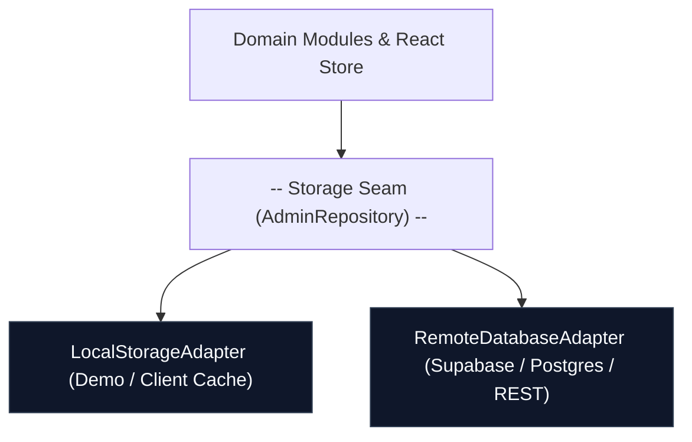

# Pretty Corner Admin — Architecture & Development To-Do

## Deferred Architecture Candidates

### 1. Introduce a Persistence Seam with Two Adapters (`ports & adapters`)
* **Status:** ⏳ Deferred until Database Integration (e.g., Supabase / PostgreSQL).
* **Source:** Architectural Review (Candidate 4).

#### Motivation & Context
Currently, [`src/context/admin-store.tsx`](file:///D:/Pretty_Corner_Dashboard/src/context/admin-store.tsx) directly invokes `window.localStorage` inside component effects and state updates. This hardcodes browser storage into the application state machine, which prevents headless node execution, unit testing without DOM window mocks, and seamless multi-device persistence.

When a real database is integrated, this seam will allow the client application to run identically with an offline/demo storage adapter or a real cloud database adapter.

#### Architectural Design


#### Seam Interface Definition (Target)
```typescript
export interface AdminRepository {
  loadInitialState(): Promise<PersistedState>;
  saveState(state: PersistedState): Promise<void>;
  
  // Entity-level atomic operations (for scalable cloud backend)
  orders: {
    getById(id: string): Promise<Order | null>;
    save(order: Order): Promise<void>;
  };
  products: {
    getAll(): Promise<Product[]>;
    save(product: Product): Promise<void>;
  };
}
```

#### Planned Adapters
1. **`LocalStorageAdapter`**: Preserves existing client offline demo and mock data fallback.
2. **`SupabaseAdapter` / `RemoteApiAdapter`**: Connects to production relational database with Row Level Security (RLS) and real-time order subscriptions.

#### Action Items for Database Phase
- [ ] Create repository interface at `src/modules/persistence/repository.ts`.
- [ ] Implement `LocalStorageAdapter` satisfying the repository contract.
- [ ] Implement `SupabaseRepositoryAdapter` connecting to PostgreSQL tables.
- [ ] Update `admin-store` to consume `AdminRepository` via dependency injection rather than invoking `window.localStorage` directly.
